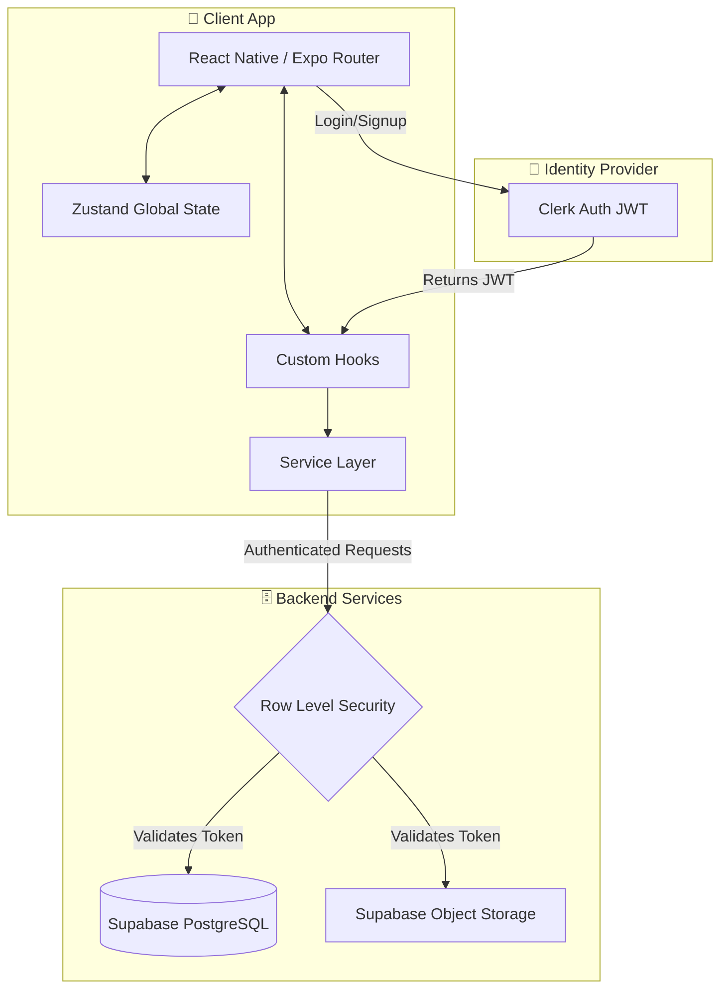

<div align="center">
  
  <h1>Jiwar | Luxury Real Estate</h1>
  <p><strong>A production-grade, full-stack real estate platform built for scale, performance, and aesthetic excellence.</strong></p>
  
  <p>
    <a href="https://reactnative.dev/"></a>
    <a href="https://expo.dev/"></a>
    <a href="https://supabase.com/"></a>
    <a href="https://clerk.com/"></a>
    <a href="https://www.typescriptlang.org/"></a>
  </p>
</div>

---

## 📖 Overview

Jiwar is a premium, cross-platform mobile application tailored for the luxury real estate market. Engineered with a focus on buttery-smooth interactions and a strict "Emerald & Pine" design system, it delivers an editorial-grade user experience on both iOS and Android.

Unlike typical MVP applications, Jiwar implements a rigorous production architecture:
- **Zero-Friction Auth**: Headless authentication flows via Clerk, fully integrated with Supabase Row Level Security (RLS).
- **Offline-First Resilience**: Global state hydrated through Zustand with intelligent query caching.
- **Performant Cartography**: Native-feeling Map integrations via OpenStreetMap and optimized WebViews.
- **Bespoke Design Token System**: A completely custom inline styling engine, ditching heavy utility frameworks for raw performance and pixel-perfect consistency.

## 🏗 System Architecture

Jiwar follows a strict unidirectional data flow and clean separation of concerns.



## 🎨 The "Emerald & Pine" Design System

We deliberately moved away from generic utility classes to implement a strict, scalable token system. This guarantees that every shadow, radius, and color perfectly aligns with the luxury brand identity across all OS paradigms.

- **Primary Axis**: Deep Pine (`#08383C`) providing a heavy, grounded corporate feel.
- **Accents**: Sage White (`#F5F8F6`) for expansive negative space, and Lime (`#4ADE80`) for high-contrast CTAs.
- **Kinematics**: Global `KeyboardAvoidingView` strategies ensure inputs are never obscured, providing a flawless administrative and registration experience.

---

## 🚀 Quick Start & Development

<details>
<summary><strong>1. Prerequisites</strong></summary>

- Node.js (v18 or higher)
- Expo CLI (`npm i -g expo-cli`)
- EAS CLI (`npm i -g eas-cli`)
- Clerk & Supabase Accounts
</details>

<details>
<summary><strong>2. Environment Configuration</strong></summary>

Clone the repository and create your `.env` file at the root:
```env
EXPO_PUBLIC_CLERK_PUBLISHABLE_KEY=pk_test_...
EXPO_PUBLIC_SUPABASE_URL=https://...supabase.co
EXPO_PUBLIC_SUPABASE_KEY=eyJhbG...
```
</details>

<details>
<summary><strong>3. Local Development</strong></summary>

```bash
npm install
npx expo start -c
```
</details>

<details>
<summary><strong>4. Compiling Native Binaries (APK / IPA)</strong></summary>

Jiwar is fully configured for Expo Application Services (EAS).
```bash
# Compile a standalone Android APK
eas build --profile preview --platform android --local
```
</details>

---

## 🔐 Security & Database Strategy (Supabase)

Data integrity and privacy are enforced strictly at the database level using PostgreSQL Row Level Security (RLS). Below is the conceptual schema implementation.

### Users & Identity Sync
When a user authenticates via Clerk, a JWT is passed to Supabase. The `users` table acts as a mirror for relational queries.

```sql
create table users (
  id uuid default gen_random_uuid() primary key,
  clerk_id text unique not null,
  email text not null,
  is_admin boolean default false,
  created_at timestamp with time zone default now()
);

alter table users enable row level security;
-- Ensures a user can only manipulate their own profile data based on the Clerk JWT 'sub' claim.
create policy "Strict User Isolation" on users for all using (clerk_id = auth.jwt()->>'sub');
```

### Relational Properties & Favorites
Properties are readable by the public, but modifications require elevated `is_admin` privileges.

```sql
create table properties (
  id uuid default gen_random_uuid() primary key,
  title text not null,
  price numeric not null,
  type text not null,
  images text[] default '{}',
  is_featured boolean default false
  -- ... geospatial data (lat/lng)
);

alter table properties enable row level security;
create policy "Public Read Access" on properties for select using (true);
create policy "Admin Write Access" on properties for insert with check (
  exists (select 1 from users where clerk_id = auth.jwt()->>'sub' and is_admin = true)
);
```

### Secured Storage Buckets
Listing images are securely routed to the `property-images` bucket. The public can view the images, but only authorized admins can mutate the blob storage.

---

## 📂 Directory Blueprint

```text
jiwar/
├── app/                      # File-based routing (Expo Router v3)
│   ├── (auth)/               # Unauthenticated boundary
│   └── (root)/               # Secure protected boundary (Tabs & Modals)
├── components/               # Pure, stateless UI components
├── constants/                # Immutable app configuration & tokens
├── hooks/                    # Stateful logic & Supabase client instantiation
├── lib/                      # Pure helper functions
├── services/                 # Backend API wrappers (Data fetching layer)
├── store/                    # Zustand state machines
└── types/                    # Strict TypeScript definitions
```

---

## 📈 Roadmap & Future Optimizations

- [ ] **Edge Caching**: Move heavy property queries to Supabase Edge Functions.
- [ ] **Image Optimization**: Implement Cloudflare Image Resizing to dynamically deliver `.webp` based on device DPI.
- [ ] **Offline Maps**: Cache OSM tiles for low-connectivity environments.
- [ ] **Biometric Auth**: Add native FaceID/TouchID integration to the Clerk flow.

---
<div align="center">
  <sub>Built with precision and passion for the luxury real estate market.</sub>
</div>
