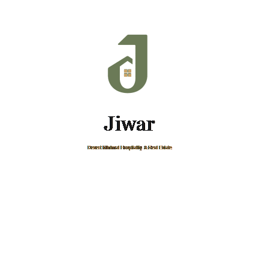

# Jiwar | Luxury Real Estate

**A production-grade, full-stack real estate platform built for scale, performance, and aesthetic excellence.**

[](https://reactnative.dev/) [](https://expo.dev/) [](https://supabase.com/) [](https://clerk.com/) [](https://www.typescriptlang.org/)

---

## 📖 Overview

Jiwar is a premium, cross-platform mobile application tailored for the luxury real estate market. Engineered with a focus on smooth interactions and a strict Desert Minimal design system, it delivers an editorial-grade user experience on iOS, Android, and the web.

Unlike typical MVP applications, Jiwar implements a rigorous production architecture:

*   **Zero-Friction Auth**: Headless authentication flows via Clerk, fully integrated with Supabase Row Level Security (RLS).
*   **Offline-First Resilience**: Global state hydrated through Zustand with intelligent query caching.
*   **Performant Cartography**: Native-feeling Map integrations via OpenStreetMap and optimized WebViews.
*   **Bespoke Design Token System**: Centralized colors, typography, spacing, radii, shadows, and component primitives for consistent product-wide styling.

---

## 🏗 System Architecture

Jiwar follows a strict unidirectional data flow and clean separation of concerns.

```
graph TD
    %% Client Tier
    subgraph Client [📱 Client App]
        UI[React Native / Expo Router]
        Store[Zustand Global State]
        Hooks[Custom Hooks]
        Services[Service Layer]
    end

    %% Auth Tier
    subgraph Identity [🔐 Identity Provider]
        Clerk[Clerk Auth JWT]
    end

    %% Data Tier
    subgraph Backend [🗄 Backend Services]
        Supabase[(Supabase PostgreSQL)]
        Storage[Supabase Object Storage]
        RLS{Row Level Security}
    end

    %% Flow
    UI <--> Store
    UI <--> Hooks
    Hooks --> Services
    UI -- "Login/Signup" --> Clerk
    Clerk -- "Returns JWT" --> Hooks
    Services -- "Authenticated Requests" --> RLS
    RLS -- "Validates Token" --> Supabase
    RLS -- "Validates Token" --> Storage
```

---

## 🎨 The "Desert Minimal" Design System

We deliberately moved away from generic utility classes to implement a strict, scalable token system. This guarantees that every shadow, radius, and color perfectly aligns with the luxury brand identity across all OS paradigms.

*   **Background**: Warm Ivory (`#FAF8F4`) with White (`#FFFFFF`) and Sand (`#F5F0E8`) surfaces.
*   **Brand**: Olive (`#6B7A57`) for primary actions, active states, and navigation.
*   **Text**: Charcoal (`#1C1C1E`) with Stone (`#6F6F6F`, `#8E8E93`) for supporting content.
*   **Accent**: Muted Gold (`#C9A46A`) reserved for premium and featured moments.
*   **Typography**: Playfair Display for editorial headings and Inter for interface/body text.
*   **Kinematics**: Global `KeyboardAvoidingView` strategies ensure inputs are never obscured, providing a flawless administrative and registration experience.

### Brand Assets

The production assets live in `assets/images/` and are wired through `app.json` for iOS, Android, web, and splash-screen builds.

| Asset | Size | Usage |
| --- | --- | --- |
| `logo.png` | 1024 × 1024 | Opaque primary app icon for iOS and store submissions |
| `adaptive-icon.png` | 1024 × 1024 | Transparent Android adaptive foreground |
| `splash.png` | 432 × 432 | Light splash logo, wordmark, and tagline |
| `splash-dark.png` | 432 × 432 | Dark-mode splash variant |
| `favicon.png` | 512 × 512 | Web favicon and in-app emblem |
| `onboarding.png` | 1200 × 800 | Auth/onboarding architectural hero image |

`components/BrandLockup.tsx` provides the shared emblem + wordmark used by the home, sign-in, and sign-up screens.

To regenerate the deterministic logo variants after changing the source mark or palette:

```
powershell -NoProfile -ExecutionPolicy Bypass -File .\scripts\generate-brand-assets.ps1
```

---

## 🚀 Quick Start & Development

**1\. Prerequisites**

*   Node.js (v20.19.x or higher for Expo SDK 54)
*   EAS CLI (`npm i -g eas-cli`)
*   Clerk & Supabase Accounts

**2\. Environment Configuration**

Clone the repository and create your `.env` file at the root:

```
EXPO_PUBLIC_CLERK_PUBLISHABLE_KEY=pk_test_...
EXPO_PUBLIC_SUPABASE_URL=https://...supabase.co
EXPO_PUBLIC_SUPABASE_KEY=eyJhbG...
```

**3\. Local Development**

```
npm install
npx expo start -c
```

**4\. Compiling Native Binaries (APK / IPA)**

Jiwar is fully configured for Expo Application Services (EAS).

```
# Compile a standalone Android APK
eas build --profile preview --platform android --local
```

---

## 📂 Project Structure & Anatomy

```
jiwar/
├── app/
│   ├── _layout.tsx              ← Root wrapper (Clerk auth setup)
│   ├── (auth)/                  ← Auth route group
│   │   ├── _layout.tsx
│   │   ├── sign-in.tsx          ← Login screen
│   │   └── sign-up.tsx          ← Register screen
│   └── (root)/                  ← Protected routes (post-login)
│       ├── _layout.tsx
│       ├── (tabs)/              ← Bottom tab navigation
│       │   ├── _layout.tsx      ← Tab navigator setup
│       │   ├── index.tsx        ← Home screen
│       │   ├── explore.tsx      ← Search & filter screen
│       │   ├── add.tsx          ← Add listing screen (admin)
│       │   ├── favorites.tsx    ← Saved/favourites screen
│       │   └── profile.tsx      ← User profile screen
│       └── property/
│           ├── [id].tsx         ← Property detail (dynamic route)
│           └── map.tsx          ← Full map view
├── components/
│   ├── PropertyCard.tsx         ← Vertical property listing card
│   ├── FeaturedCard.tsx         ← Horizontal featured carousel card
│   └── FilterModal.tsx          ← Advanced search & filtering bottom sheet
├── constants/
│   └── filters.ts               ← Property type, bedroom, and price constants
├── hooks/
│   ├── useSupabase.ts           ← Authenticated Supabase client
│   ├── useSavedProperty.ts      ← Save / unsave a property
│   └── useUserSync.ts           ← Syncs Clerk user → Supabase
├── lib/
│   ├── supabase.ts              ← Supabase client setup
│   └── utils.ts                 ← Helper functions (formatPrice…)
├── services/
│   ├── properties.ts            ← fetchProperties, searchProperties
│   └── saved.ts                 ← checkIfPropertySaved, saveProperty, unsaveProperty
├── store/
│   ├── filterStore.ts           ← Search filter state (Zustand)
│   └── userStore.ts             ← User/admin state (Zustand)
├── types/
│   └── index.ts                 ← Shared interfaces & types
├── assets/images/               ← App icons, splash assets, favicon, auth hero
├── scripts/
│   └── generate-brand-assets.ps1 ← Rebuilds palette-accurate brand variants
└── app.json                     ← Expo config
```

---

## 🧩 Architectural Breakdown

### 🔑 Types (`types/index.ts`)

Shared domain types used across screens, stores, and constants to ensure strict type safety.

```
export type PropertyTypeValue = "apartment" | "house" | "villa" | "studio" | "townhouse" | "penthouse" | "plot" | "flat" | "other";

export interface Property {
  id: string;
  title: string;
  description: string;
  price: number;
  type: PropertyTypeValue;
  bedrooms: number;
  bathrooms: number;
  area_sqft: number;
  address: string;
  city: string;
  latitude: number;
  longitude: number;
  images: string[];
  is_featured: boolean;
  is_sold: boolean;
  created_at: string;
}
```

### Global State (`store/`)

Zustand is used for frictionless global state management, avoiding the overhead of heavy prop drilling.

*   `**filterStore.ts**`: Maintains the active search query, property type, bedroom count, and budget constraints (`minPrice`/`maxPrice`).
*   `**userStore.ts**`: Tracks the user session and `isAdmin` flag to dynamically reveal administrative capabilities (like the Add Listing tab).

### Hooks (`hooks/`)

*   `**useSupabase()**`: Intercepts the Clerk JWT and attaches it to all Supabase requests, ensuring operations are evaluated against RLS policies.
*   `**useSavedProperty()**`: Handles the optimistic UI updates and loading states for toggling favorites.
*   `**useUserSync()**`: A background hook that silently upserts the Clerk profile into the PostgreSQL `users` table upon successful login.

### Services (`services/`)

Data fetching logic is decoupled from the UI. Screen components merely consume these services.

*   `**properties.ts**`: `fetchProperties()`, `searchProperties(term, type, min, max)`
*   `**saved.ts**`: `checkIfPropertySaved()`, `saveProperty()`, `unsaveProperty()`

---

## 🔄 App Workflow & Data Flow

### 1\. Authentication

```
sign-in.tsx → Clerk handles login
  → Stores token securely (expo-secure-store)
  → Redirects to (root)/(tabs)
  → useUserSync() runs → upserts user row in Supabase
```

### 2\. Exploring & Filtering

```
explore.tsx
  → TextInput updates filterStore.setSearch()
  → useEffect watches [search, type, bedrooms, minPrice, maxPrice]
  → Builds and runs a Supabase query inline via services/searchProperties
  → FilterModal taps → setType / setBedrooms / setMinPrice / setMaxPrice
  → Active filters shown as removable chips below the search bar
```

### 3\. Admin: Add Listing

```
add.tsx (only visible if isAdmin = true in userStore)
  → Form: title, description, price, type, beds, baths, area, address, coords
  → Images uploaded to Supabase Storage → URLs stored in images[]
  → Location detected via expo-location or entered manually
  → Submit → authSupabase.from("properties").insert(...)
  → RLS verifies is_admin = true before allowing insert
```

---

## 🔐 Security & Database Strategy (Supabase Setup)

Data integrity and privacy are enforced strictly at the database level using PostgreSQL Row Level Security (RLS). Run all SQL below in your Supabase SQL editor to scaffold the backend.

**1\. Users Table & RLS Policies**

```
create table users (
  id uuid default gen_random_uuid() primary key,
  clerk_id text unique not null,
  email text not null,
  first_name text,
  last_name text,
  avatar_url text,
  is_admin boolean default false,
  created_at timestamp with time zone default now()
);

alter table users enable row level security;
create policy "Users can insert own row" on users for insert with check (clerk_id = auth.jwt()->>'sub');
create policy "Users can read own row" on users for select using (clerk_id = auth.jwt()->>'sub');
create policy "Users can update own row" on users for update using (clerk_id = auth.jwt()->>'sub');
```

**2\. Properties Table & RLS Policies**

```
create table properties (
  id uuid default gen_random_uuid() primary key,
  title text not null,
  description text,
  price numeric not null,
  type text not null,
  bedrooms int not null default 1,
  bathrooms int not null default 1,
  area_sqft int,
  address text not null,
  city text not null,
  latitude float,
  longitude float,
  images text[] default '{}',
  is_featured boolean default false,
  is_sold boolean default false,
  created_at timestamp with time zone default now()
);

alter table properties enable row level security;
create policy "Properties are publicly readable" on properties for select using (true);
```

**3\. Saved Properties Table & RLS Policies**

```
create table saved_properties (
  id uuid default gen_random_uuid() primary key,
  user_clerk_id text not null references users(clerk_id) on delete cascade,
  property_id uuid not null references properties(id) on delete cascade,
  created_at timestamp with time zone default now(),
  unique(user_clerk_id, property_id)
);

alter table saved_properties enable row level security;
create policy "Users can read own saved properties" on saved_properties for select using (user_clerk_id = auth.jwt()->>'sub');
create policy "Users can insert saved properties" on saved_properties for insert with check (user_clerk_id = auth.jwt()->>'sub');
create policy "Users can delete own saved properties" on saved_properties for delete using (user_clerk_id = auth.jwt()->>'sub');
```

**4\. Admin Configuration & Storage Bucket**

```
insert into storage.buckets (id, name, public) values ('property-images', 'property-images', true);
create policy "Public can read property images" on storage.objects for select using (bucket_id = 'property-images');

create policy "Admin can insert properties" on properties for insert with check (exists (select 1 from users where clerk_id = auth.jwt()->>'sub' and is_admin = true));
create policy "Admin can update properties" on properties for update using (exists (select 1 from users where clerk_id = auth.jwt()->>'sub' and is_admin = true));
create policy "Admin can delete properties" on properties for delete using (exists (select 1 from users where clerk_id = auth.jwt()->>'sub' and is_admin = true));
create policy "Admin can upload property images" on storage.objects for insert with check (bucket_id = 'property-images' and exists (select 1 from users where clerk_id = auth.jwt()->>'sub' and is_admin = true));

-- Make yourself an admin (replace with your Clerk ID):
-- update users set is_admin = true where clerk_id = 'user_xxxxxxxxxxxxxxxx';
```

**5\. Seed Properties Data**

All seed images are Unsplash photos of homes, apartments, villas, and commercial buildings.

```
insert into properties (
  title, description, price, type, bedrooms, bathrooms,
  area_sqft, address, city, latitude, longitude, images, is_featured
) values

(
  'DHA Phase 6 Grand Villa',
  'A magnificent villa nestled in the heart of DHA Lahore with a private heated pool, landscaped garden, Italian marble flooring, and a fully integrated smart home system. Ideal for families seeking premium living with top-tier security.',
  95000000,
  'villa',
  5, 4, 5200,
  'Street 14, Phase 6, DHA',
  'Lahore',
  31.4726, 74.4085,
  ARRAY[
    'https://images.unsplash.com/photo-1613490493576-7fde63acd811?w=800',
    'https://images.unsplash.com/photo-1613977257365-aaae5a9817ff?w=800',
    'https://images.unsplash.com/photo-1600596542815-ffad4c1539a9?w=800'
  ],
  true
),

(
  'Clifton Skyline Penthouse',
  'Breathtaking full-floor penthouse on the 30th floor of a landmark Clifton tower. Enjoy sweeping views of the Arabian Sea from your private rooftop terrace, entertain in the open-plan living area, and unwind in the spa-inspired bathrooms.',
  145000000,
  'penthouse',
  4, 4, 3800,
  'Block 5, Clifton',
  'Karachi',
  24.8138, 67.0300,
  ARRAY[
    'https://images.unsplash.com/photo-1502672260266-1c1ef2d93688?w=800',
    'https://images.unsplash.com/photo-1512917774080-9991f1c4c750?w=800',
    'https://images.unsplash.com/photo-1560185007-cde436f6a4d0?w=800'
  ],
  true
),

(
  'Bahria Town Luxury Apartment',
  'Spacious 3-bedroom apartment on a high floor in Bahria Town Islamabad. Floor-to-ceiling windows frame the lush Margalla Hills, while the premium interiors include a modular kitchen, home theatre setup, and covered parking for two cars.',
  26000000,
  'apartment',
  3, 2, 1900,
  'Bahria Town, Phase 7, Tower A',
  'Islamabad',
  33.5296, 73.1340,
  ARRAY[
    'https://images.unsplash.com/photo-1522708323590-d24dbb6b0267?w=800',
    'https://images.unsplash.com/photo-1484154218962-a197022b5858?w=800',
    'https://images.unsplash.com/photo-1545324418-cc1a3fa10c00?w=800'
  ],
  true
);
```

---

## 📌 Key Concepts for Beginners

| Concept | What it means |
| --- | --- |
| File-based routing | Each file = a screen. No manual route config needed. |
| Dynamic routes | `[id].tsx` becomes `/property/123`, `/property/456`, etc. |
| Route groups | `(auth)` organises files without affecting the URL path |
| Components | Reusable UI blocks (like functions that return UI) |
| Hooks | Functions that add state or behaviour to components |
| Zustand store | Global data shared across any component without prop drilling |
| TypeScript | JavaScript with type hints — catches bugs before runtime |
| RLS (Row Level Security) | Supabase checks who you are before allowing DB operations |
| JWT | Clerk login token — passed to Supabase to prove your identity |

---

## ✅ Feature Checklist

*   Secure Email/Password Authentication (Clerk)
*   OTP email verification on signup
*   JWT Integration with Supabase Row Level Security (RLS)
*   Premium "Desert Minimal" UI system (centralized design tokens)
*   Property listing with image carousel & deep linking
*   Featured properties horizontal scroll
*   Full-text search by title and city
*   Advanced Filters (Type, Bedrooms, Min/Max Price)
*   Global State Management (Zustand)
*   User Favorites / Saved Properties
*   Embedded Map Preview (OpenStreetMap)
*   Full-screen map view & WhatsApp contact integrations
*   Admin Listing Upload (with Image Storage)
*   Admin Dashboard capabilities (mark as sold, delete listings)
*   Robust Keyboard Avoidance across all platforms
*   Custom Android Adaptive Icons & Splash Screens

---

## 📈 Roadmap & Future Optimizations

*   **Edge Caching**: Move heavy property queries to Supabase Edge Functions.
*   **Image Optimization**: Implement Cloudflare Image Resizing to dynamically deliver `.webp` based on device DPI.
*   **Offline Maps**: Cache OSM tiles for low-connectivity environments.
*   **Biometric Auth**: Add native FaceID/TouchID integration to the Clerk flow.

---
